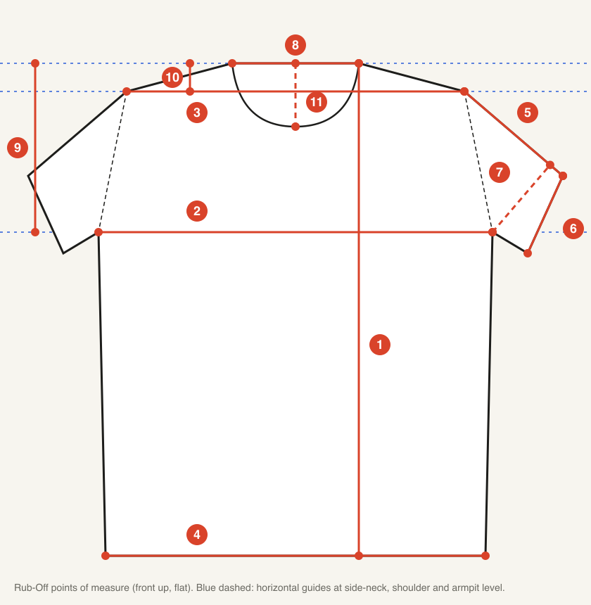

# 줄자로 재는 법 (상의: 티셔츠·셔츠·후드)

앱이 사진에서 재는 것과 **같은 점, 같은 방법**으로 재야 비교가 된다. 번호는 `docs/measure-top.png`.



## 준비

- 옷을 바닥에 **앞면이 위로** 펴고, 손바닥으로 주름만 편다. 잡아당겨 늘리지 않는다(니트는 특히).
- 모든 폭은 **단면**(펴놓은 앞뒤 두 겹 그대로, 한쪽 끝에서 다른 쪽 끝까지 직선). 둘레가 아니다.
- **곡선을 따라가지 않고 두 점 사이 직선**으로 잰다. 줄자를 팽팽하게.
- 0.5 cm 단위로 적는다.
- "수직"은 옷의 중심선(앞중심) 방향, "수평"은 그에 직각. 긴 자나 책 모서리를 수평으로 대면 편하다(그림의 파란 점선).

## 측정점

| 번호 | 이름 | 어디서 어디까지 | 앱 키 |
| --- | --- | --- | --- |
| 1 | 총장 | **옆목점**(어깨선이 목둘레 시보리·칼라와 만나는 가장 높은 점)에서 중심선과 평행하게 **수직으로** 밑단 끝까지. 대각선이 아님 | `length` |
| 2 | 가슴단면 | 좌우 **겨드랑이점**(소매 밑선과 옆선이 만나는 솔기점) 사이 직선. 겨드랑이 아래 2.5 cm가 아님 | `chest` |
| 3 | 어깨너비 | 좌우 **어깨점**(소매 솔기가 어깨선과 만나는 점) 사이 직선. 드롭숄더는 솔기가 팔 쪽으로 내려가 있어도 솔기점에서 잰다 | `shoulder` |
| 4 | 밑단단면 | 밑단 양 끝(옆선과 밑단이 만나는 점) 사이 직선. 립·시보리는 늘리지 않은 상태 | `hem` |
| 5 | 소매길이 | 어깨점에서 소매 **윗선(바깥 접힌 선)을 따라 직선으로** 소맷부리 바깥 모서리까지. 커프스·시보리 포함 | `sleeve` |
| 6 | 소매단면 | 소맷부리 양 끝(윗선 쪽 모서리 ~ 아래 모서리) 사이 직선 | `sleeveOpening` |
| 7 | 팔통 | 겨드랑이점에서 소매 윗선까지, **소매 윗선에 직각으로** | `bicep` |
| 8 | 목너비 | 좌우 옆목점 사이 직선(시보리 바깥쪽 끝) | `neckWidth` |
| 9 | 진동깊이 | 옆목점 높이에서 겨드랑이점 높이까지 **수직 거리**. 옆목점에 자를 수평으로 대고, 겨드랑이점에서 그 자까지 수직으로 | `armholeDepth` |
| 10 | 어깨처짐 | 옆목점 높이에서 어깨점까지 수직 거리 | `shoulderDrop` |
| 11 | 앞목깊이 | 옆목점 높이에서 앞중심의 목둘레 **봉제선**(시보리 안쪽 선)까지 수직 거리. 사진으로는 못 재는 값 | `frontNeckDrop` |
| — | 뒷목깊이 | 뒤집어서, 옆목점 높이에서 뒷중심 목둘레 봉제선까지 수직 거리. 사진으로는 못 잼 | `backNeckDrop` |

후드 집업은 추가로: 모자 높이(어깨선과 모자가 만나는 목 솔기에서 모자 꼭대기까지), 모자 폭(얼굴선에서 모자 뒤 가장 먼 곳까지), 시보리 높이(밑단 시보리의 세로 폭).

## 우선순위

시간이 없으면 1–6과 8만. 사진 검증에는 이것으로 충분하다. 11과 뒷목깊이는 패턴을 실제로 자를 때 필요.

## 앱에 넣기

```bash
npm run photo -- 앞.jpg 뒤.jpg --garment=t-shirt --fabric=knit --tape=length:70,chest:56,shoulder:49,hem:55,sleeve:20,sleeveOpening:18,neckWidth:17
```

사진 값 옆에 줄자 값과 차이(%)가 찍힌다. 웹 화면에서는 치수 칸에 그대로 입력하면 사진 값 대신 쓰인다.

## 사진 찍을 때 (다음 촬영)

- 옷 **전체가 화면 안**, 가장자리에서 손가락 한두 마디 여유. 소맷부리가 화면 끝에 닿으면 그쪽 소매는 재지 않는다.
- A4 네 모서리가 모두 보이게. 옷 위에 올려도 되고 옆에 둬도 된다. 주름진 곳 위는 피한다.
- 폰을 옷 한가운데 위에서 바닥과 평행하게. 비스듬히 찍으면 A4로 보정하지만 오차가 커진다.
- 목이 화면 위쪽. 소매는 몸판에서 떨어뜨려 펴기.
